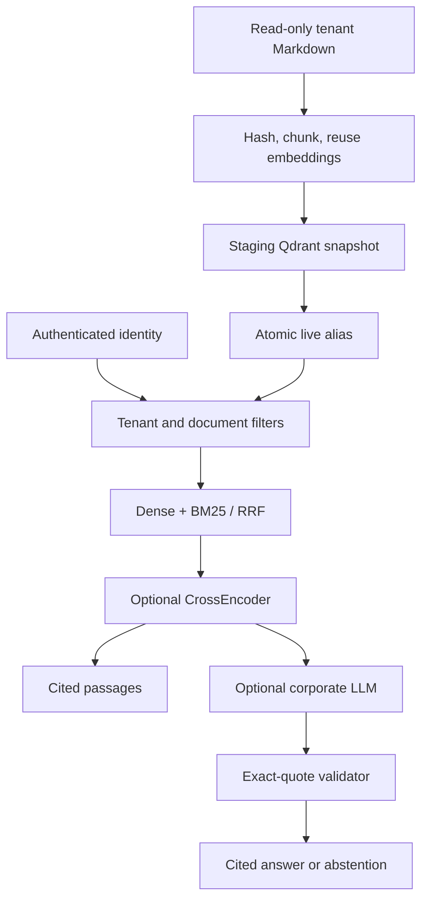

# Atlas RAG

**Turn internal documentation into permission-aware search and verifiable answers, using your own models.**

[](https://github.com/Alex-proktor/atlas-rag/actions/workflows/ci.yml)

Atlas is a Python / FastAPI / Qdrant reference platform for internal knowledge assistants. It combines multilingual semantic retrieval with BM25, atomically publishes document updates, and enforces tenant and document permissions before retrieval. Bring an OpenAI-compatible model endpoint; no Llama or Ollama dependency.

**Adoption scope:** a bounded, single-node reference deployment for evaluation and customization. It is not a certified enterprise product. See [security boundaries](docs/security.md) before using confidential data.

## Five-minute walkthrough

Requires Docker Compose and Python 3.11+. Initial image/model downloads depend on your connection.

```bash
git clone https://github.com/Alex-proktor/atlas-rag.git
cd atlas-rag
python scripts/configure_demo.py
docker compose up --build -d
python scripts/demo.py
```

The setup generates a random local credential. The demo indexes the synthetic English/Russian handbook, searches it, verifies a cited source and confirms that unauthenticated retrieval is rejected. It never uses your private documents or calls a paid model. Interactive API documentation: http://127.0.0.1:8000/docs.

Example request after setting `ATLAS_TOKEN` from your private `.local-token`:

```bash
curl http://127.0.0.1:8000/search \
  -H "Authorization: Bearer $ATLAS_TOKEN" \
  -H "Content-Type: application/json" \
  -d '{"query":"How long are database backups retained?","limit":3}'
```

Results include original passages, document path, chunk number, and ranking scores. The sample backup policy says **30 days**. This is fictional demonstration content.

## What is implemented

| Capability | Implementation |
|---|---|
| Document lifecycle | Content hashes, stable tenant/path/chunk IDs, incremental embedding reuse, scoped deletion sync, full immutable snapshots, atomic Qdrant alias swap |
| Retrieval | Local multilingual Sentence Transformers, BM25, reciprocal-rank fusion; optional multilingual CrossEncoder reranking |
| Answers | OpenAI-compatible chat completions; exact quotations validated against retrieved sources; server-generated citations and explicit abstention |
| Access control | Hashed bearer credentials mapped to server-side tenant, groups and role; prefiltered dense and lexical search; separate tenant filesystem roots |
| Operations | Docker Compose, non-root API, resource caps, health/readiness endpoints, metadata-only audit, request/rate limits |
| Integration | Read-only Hermes plugin, with evidence explicitly marked as untrusted data |
| Quality | Real Qdrant lifecycle/failure/ACL tests, real HTTP provider-contract tests, multilingual labeled evaluation and reproducible commands |

## Architecture



The LLM never decides access rights, executes tools, or receives secrets. Generation is deliberately extractive: the model selects relevant quotations; the server validates and formats them. Citation validation proves provenance, **not semantic relevance**. This restriction is documented rather than presented as unrestricted grounded synthesis.

## Bring your documents and models

Place Markdown under `examples/<tenant>/`. A credential's tenant selects the root; API clients cannot override tenant or groups. `POST /index` synchronizes a relative directory, including deleted files and shorter documents. `acl: []` means everyone **within that tenant**; nonempty ACLs require membership in at least one group. Only writer/admin credentials can index. Read [deployment](docs/deployment.md) for credentials, migrations, backup and retention.

| Variable | Purpose |
|---|---|
| `ATLAS_IDENTITIES` | JSON list: subject, tenant, groups, role, token_sha256; no default credential |
| `DOCS_ROOT` | Parent of tenant directories; read-only mount |
| `QDRANT_URL` / `COLLECTION` | Internal database endpoint and logical index namespace |
| `STATE_ROOT` | Shared writer lock directory; required persistent state |
| `EMBEDDING_MODEL` | Sentence Transformers model; changing it requires a new collection |
| `RERANKER_MODEL` | Optional CrossEncoder, e.g. cross-encoder/mmarco-mMiniLMv2-L12-H384-v1 |
| `LLM_BASE_URL` / `LLM_MODEL` / `LLM_API_KEY` | Optional OpenAI-compatible endpoint, model, environment secret |
| `LLM_ALLOW_EXTERNAL=true` | Explicit consent to transmit authorized passages to an external HTTPS provider |
| `ATLAS_PORT` | Loopback API port; default 8000 |

Enable generation only after choosing an approved provider and data policy. Set the LLM variables in `.env`, restart the API, then call `POST /answer` with the same query schema as search. With no provider configured, search remains local; answer returns a safe 503 when evidence exists. No silent provider fallback.

## Verification and evaluation

```bash
python -m pip install -e ".[dev]"
# Start a disposable Qdrant instance and set QDRANT_TEST_URL first.
pytest -q
ruff check atlas_rag tests integrations
bandit -r atlas_rag integrations
pip-audit
# Uses actual embedding model + Qdrant, not a mocked search:
python -m atlas_rag.evaluate --dataset evaluation/queries.json
```

Measured on the 24-query synthetic bilingual set (real model + Qdrant, CI run 39230021766):

| Retrieval | Recall@3 | MRR@3 | nDCG@3 |
|---|---:|---:|---:|
| BM25 | 1.0000 | 0.9792 | 0.9846 |
| Dense | 0.9583 | 0.9375 | 0.9430 |
| Hybrid RRF | 1.0000 | 1.0000 | 1.0000 |
| Hybrid + CrossEncoder | 1.0000 | 1.0000 | 1.0000 |

These are in-sample demonstration results, not a general accuracy claim. The real reranker was exercised; it does not improve this easy set. Independent enterprise evaluation remains necessary.

See [evaluation protocol and limitations](docs/evaluation.md), the committed machine-readable results in `evaluation/`, and [acceptance evidence](docs/acceptance.md). Integration tests explicitly skip when their required real service is absent; CI supplies it. A small bilingual synthetic corpus demonstrates reproducibility, not general enterprise accuracy.

## Integrate and adapt

- [Deployment and adoption guide](docs/deployment.md)
- [Threat model and security limits](docs/security.md)
- [Hermes plugin contract](docs/hermes.md)
- [Architecture decisions and sources](docs/architecture.md)
- [Release checklist](docs/release.md)

For a real company rollout: replace the demo identities with an identity gateway, load a representative corpus and relevance judgments, validate multilingual quality, obtain a security review and set retention/backup policy. Keep this repository free of proprietary documents and credentials.

MIT licensed — [LICENSE](LICENSE).
